# BankApp — UML Diagrams

Complete UML documentation of the project, generated from the source code in
`BankApp/`. Every diagram exists in two forms:

- **`.png`** — rendered image (view below or open directly)
- **`.mmd`** — editable [Mermaid](https://mermaid.js.org/) source; GitHub and VS
  Code (with the Mermaid extension) render these automatically, and
  [mermaid.live](https://mermaid.live.com) can be used to tweak them.

| # | Diagram | Shows |
|---|---------|-------|
| 0 | [Architecture overview](#0--architecture-overview) | packages and who-uses-whom |
| 1 | [Users & Authentication](#1--users--authentication) | User, UserService, AuthService (Marias) |
| 2 | [Accounts](#2--accounts) | AccountManager, BankAccount, SavingsAccount (Gustaf) |
| 3 | [Transaction Layer — transfers](#3--transaction-layer--transfers-staging--scheduling) | BankTransfer → staging → scheduler (Alex) |
| 4 | [Transaction Layer — exchange & locator](#4--transaction-layer--exchange-rates--service-locator) | ExchangeRate, registry, service locator (Alex) |
| 5 | [Loans](#5--loans) | Loan, LoanService, interest & credit-score services (Jonathan) |
| 6 | [Menus & presentation](#6--menus--presentation) | Menu, LoanMenu, Theme, EmailService (Robin) |
| 7 | [Pull The Sack — game model](#7--pull-the-sack--game-model) | facade, controller, slot machine, payout |
| 8 | [Pull The Sack — views & console](#8--pull-the-sack--views--console) | views, view updater, locked console, input |
| S1 | [Login sequence](#s1--login-with-3-strike-lockout) | login incl. lockout after 3 failures |
| S2 | [Loan sequence](#s2--loan-application-pricing--decision) | application, pricing, approval |
| S3 | [Transfer sequence](#s3--transfer-staging--scheduled-execution) | staged transfer + 15-min batch tick |
| S4 | [Game sequence](#s4--pull-the-sack-session) | full slot-machine session |

## Notation

Class diagrams use standard UML notation:

| Line | Meaning |
|------|---------|
| `──▷` solid line, hollow triangle | inheritance (`extends`) |
| `┄┄▷` dashed line, hollow triangle | interface realization (`implements`) |
| `──▶` solid line, open arrow | association — holds a reference (often ctor-injected) |
| `┄┄▶` dashed line, open arrow | dependency — «uses» / «create» |
| `◆──` filled diamond at owner | composition — owner owns the part |
| `◇──` hollow diamond at owner | aggregation |

Boxes carry stereotypes: `«interface»`, `«enumeration»`, `«record»` /
`«record struct»`, `«utility»` (static class), `«external»` (type from another
module, shown only as a stub), `«API»`, `«Controller»`, `«global namespace»`.
`+`/`-`/`#` mean public/private/protected.

Sequence diagrams: solid arrows = calls, dashed arrows = returns, `alt`/`opt`/
`loop` frames group alternative/optional/repeated behaviour. Actor boxes are
orange, participants are blue.

---

## 0 — Architecture overview

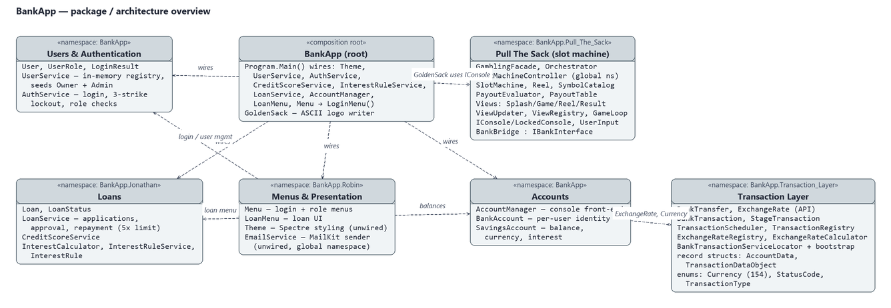

`Program.Main` is the composition root: it constructs every service by hand and
starts `Menu.LoginMenu()`. The dashed arrows show which package uses which.

- **Robin's UI package is the hub** — `Menu` needs `AuthService`/`UserService`
  for login and account creation, and `LoanMenu` drives both `LoanService` and
  `AccountManager`.
- **The Transaction Layer is a self-contained module** with its own API,
  controller, registries and service locator. The only current consumer is
  `AccountManager` (via the `ExchangeRate` API and the `Currency` enum).
- **The game module** (`Pull The Sack`) is connected to the bank through
  `IBankInterface`/`BankBridge` and `GamblingFacade`; it is not yet started
  from `Program.Main`, and only `GoldenSack` uses its `IConsole` abstraction.

Namespaces do not always match folders — the packages above follow the declared
namespaces: Marias' types are in `BankApp`, the Transaction Layer mixes
`API`, `Controller`, `Data`, `DataModel`, `Enum`, `Service`, `Service_Locators`
and `Infrastructure`, `EmailService` sits in the *global* namespace, and so
does `SlotMachineController`.

## 1 — Users & Authentication

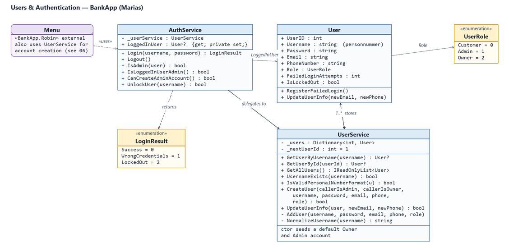

Maria's module (namespace `BankApp`). `UserService` owns all `User` records in
a dictionary and seeds a default Owner and Admin account in its constructor.
`AuthService` wraps it with the login rules: personnummer usernames are
normalized (dashes stripped, 12 digits required), three failed attempts lock
the account (`User.IsLockedOut`), and admins can unlock accounts again.
`LoginResult` tells the menu which branch to show.

## 2 — Accounts

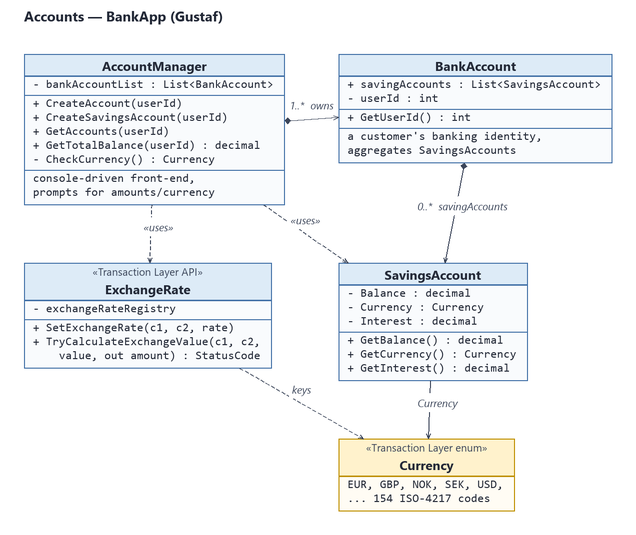

Gustaf's module (namespace `BankApp`). `AccountManager` is the console
front-end: it creates `BankAccount`s per user and appends `SavingsAccount`s
to a public list on each `BankAccount`. `GetTotalBalance` totals the savings
balances and converts foreign-currency accounts through the Transaction
Layer's `ExchangeRate` API (which currently returns 0 for conversions,
because no exchange rates are ever set — see [observation 3](#observations)).

Note: despite the comment "Upper class of SavingsAccount" in `BankAccount.cs`,
the relation is **composition**, not inheritance.

## 3 — Transaction Layer — transfers, staging & scheduling

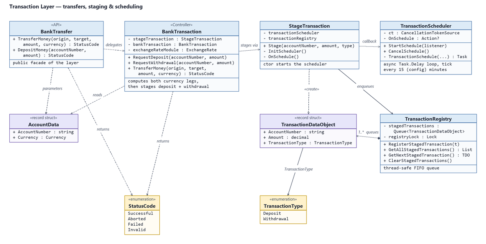

Alex's module (namespace `BankApp.Transaction_Layer`). The flow implements
user story 15 — transactions must not execute immediately but every 15th
minute:

1. `BankTransfer.TransferMoney` (public API) delegates to the
   `BankTransaction` controller.
2. The controller computes the two currency legs via `ExchangeRate`, then asks
   `StageTransaction` to **stage** a deposit and a withdrawal.
3. Each staged item becomes an immutable `TransactionDataObject` in the
   thread-safe `TransactionRegistry` queue.
4. `TransactionScheduler` is an async `Task.Delay` loop started from
   `StageTransaction`'s constructor; every tick it calls back into
   `StageTransaction.OnSchedule`, which drains and clears the queue.

`AccountData` and `TransactionDataObject` are `readonly record struct`s —
value types with positional init-only properties.

## 4 — Transaction Layer — exchange rates & service locator

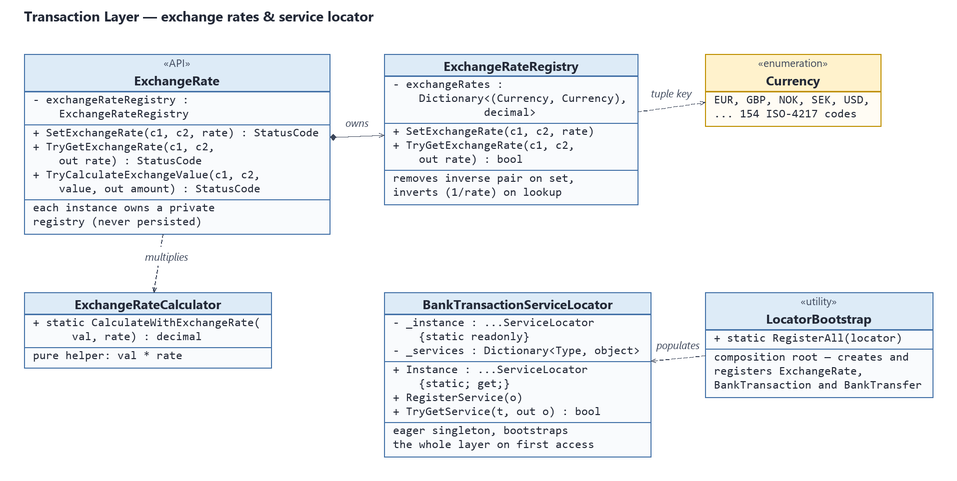

`ExchangeRate` (API) owns a private `ExchangeRateRegistry` — a dictionary keyed
by `(Currency, Currency)` pairs. Setting a rate removes the inverse pair
(single source of truth); looking up the reverse direction inverts the rate
(1/rate). `ExchangeRateCalculator` is a pure static helper (value × rate).
`BankTransactionServiceLocator` is an eager singleton: its first access runs
`LocatorBootstrap.RegisterAll`, which builds the whole module graph and
registers `ExchangeRate`, `BankTransaction` and `BankTransfer` by concrete
type. Nothing resolves services from the locator yet (see
[observations](#observations)).

## 5 — Loans

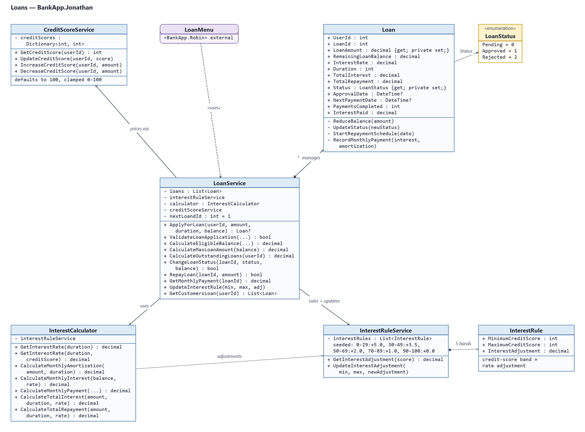

Jonathan's module. `LoanService` is the aggregate root: it owns all `Loan`s
and implements the business rules — borrowing limited to **5× the customer's
balance** (user story 12), duration 12–144 months, amounts rounded to whole
krönor. Pricing combines a duration tier (6.5–9.25 %) with a credit-score
adjustment from `InterestRuleService` (five bands, 0–29 → +5.0 pp up to
90–100 → +0.0 pp; `CreditScoreService` defaults every customer to 100).
`InterestCalculator` is the stateless math engine (monthly amortization,
interest, payment, totals). The `Loan` entity guards its own lifecycle:
`Status` starts `Pending`, `UpdateStatus` only accepts `Approved`/`Rejected`
while pending, and `StartRepaymentSchedule` requires approval.

## 6 — Menus & presentation

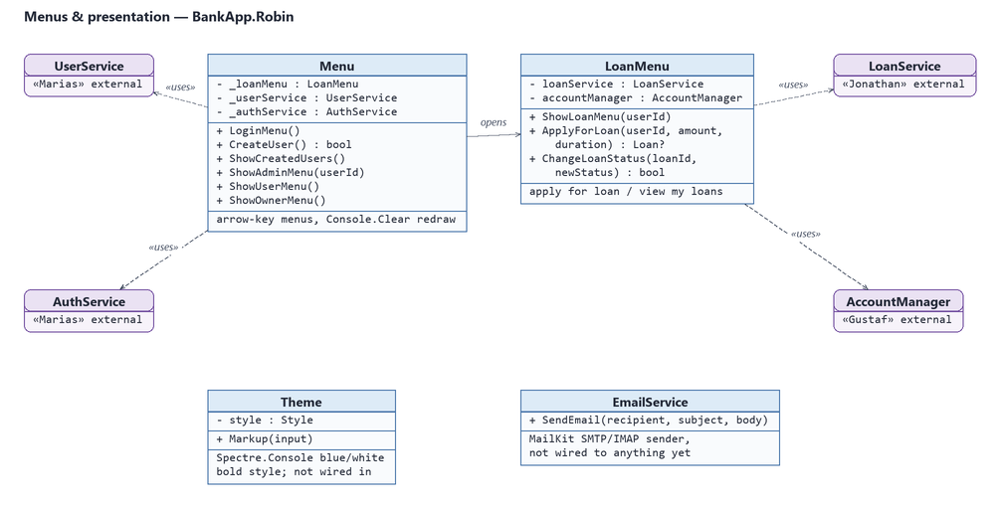

Robin's module. `Menu` implements the login screen and the role menus
(owner/admin/customer) with arrow-key navigation; `LoanMenu` wraps the loan
UI. The four stub boxes on the right/bottom are the module's dependencies on
other students' packages. `Theme` (Spectre.Console styling) and
`EmailService` (MailKit SMTP sender) exist but are not wired to any caller
yet — notifications (user story 18) are still open.

## 7 — Pull The Sack — game model

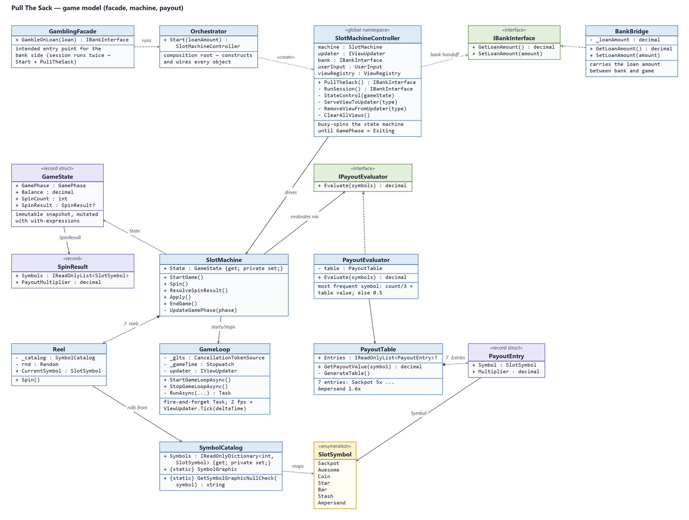

The slot-machine mini-game. `GamblingFacade.GambleOnLoan(loan)` is the
intended entry point for the bank side; `Orchestrator.Start` is the
composition root that news up the entire object graph. `SlotMachineController`
(note: global namespace) runs a tight state machine over
`SlotMachine.State.GamePhase` until `Exiting`, then hands the
`IBankInterface` (BankBridge) back to the caller. `SlotMachine` owns three
`Reel`s that roll random `SlotSymbol`s from the `SymbolCatalog`; the
`PayoutEvaluator`/`PayoutTable` pair prices the result (most frequent symbol
× multiplier). `GameLoop` fires `ViewUpdater.Tick` every 500 ms on a
background task.

## 8 — Pull The Sack — views & console

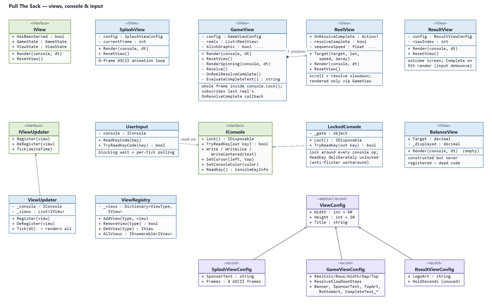

The presentation half of the game. Every view implements `IView`
(`HasBeenServed`, a `GameState` snapshot, `ViewState`, `Render(console, dt)`).
`ViewUpdater` re-renders the registered views each tick; the controller swaps
them via `ViewRegistry` (Splash → Game → Result). `GameView` composes three
`ReelView`s and drives the resolve animation; `ReelView.OnResolveComplete` is
an event-like `Action?` property the GameView subscribes to. All console I/O
is funnelled through `IConsole`; `LockedConsole` serializes it with a
`lock(_gate)` per operation plus a Monitor-based `Lock()/Releaser` for
whole-frame atomicity (rendering and input come from different threads).
The config records form the only inheritance chain in the project
(`ViewConfig` → Game/Result/Splash configs). `BalanceView` is constructed
but never registered (dead code).

---

## S1 — Login with 3-strike lockout

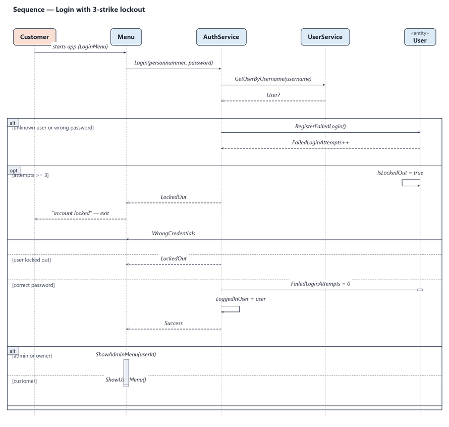

`Menu.LoginMenu` asks for personnummer + password and calls
`AuthService.Login`. The `alt` frame shows the three outcomes: wrong
credentials increment `User.FailedLoginAttempts` (the third failure sets
`IsLockedOut`), locked-out users are turned away, and success resets the
counter and routes to the role-specific menu.

## S2 — Loan application, pricing & decision

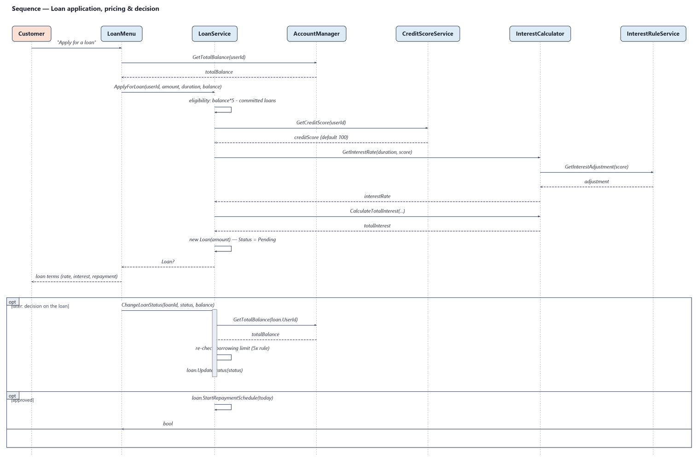

`LoanMenu.ApplyForLoan` gathers the customer's total balance from
`AccountManager`, then `LoanService.ApplyForLoan` checks eligibility
(available credit = 5 × eligible balance − committed loans), fetches the
credit score, prices the loan through `InterestCalculator` +
`InterestRuleService`, and stores a new `Pending` `Loan`. The `opt` frame
shows the later decision: `ChangeLoanStatus` re-checks the borrowing limit,
updates the loan and — on approval — starts the monthly repayment schedule.

## S3 — Transfer staging & scheduled execution

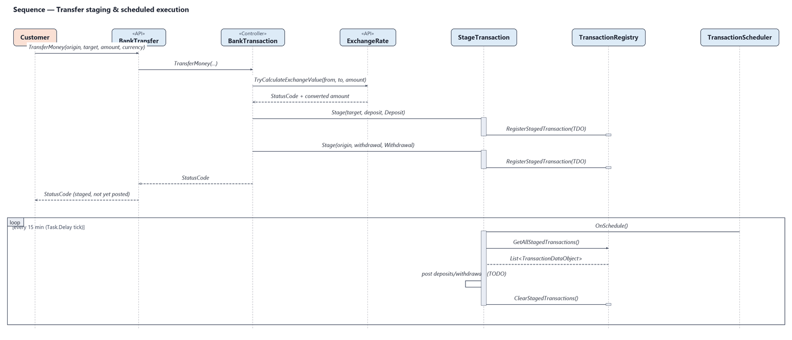

A transfer never moves money directly: `BankTransaction` computes the
exchange-rate legs and stages a deposit + withdrawal in the
`TransactionRegistry`. The customer only gets a "staged" status code. The
`loop` frame shows the scheduler tick that drains the queue — where the
actual balance posting would happen (currently a TODO, see
[observations](#observations)).

## S4 — Pull The Sack session

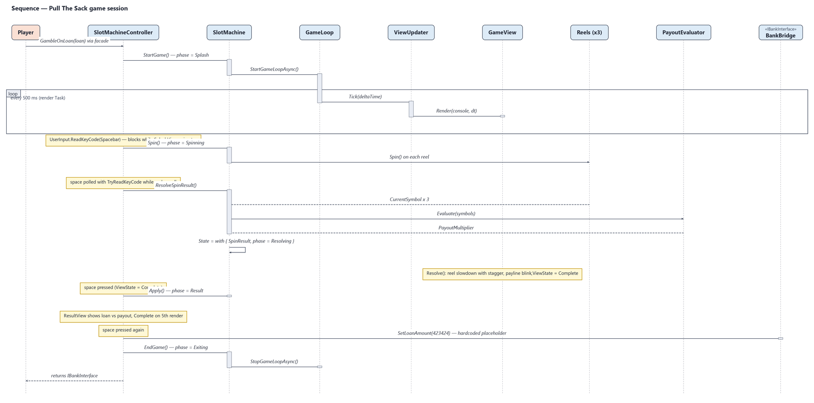

One full game session: the render loop (async Task, 2 fps) re-renders the
active view while the controller's state machine polls input on the main
thread. Space spins the reels, the payout evaluator prices the symbols, the
GameView slows the reels down and blinks the payline, and after the result
screen the updated loan amount is written back through `IBankInterface`
(currently a hardcoded placeholder).

---

## Observations

Findings from the code-reading pass that are worth knowing (all visible in the
diagrams above):

1. **Build blockers** — `LocatorBootstrap` passes 1 argument to the
   `BankTransaction` constructor (declared with 3) and 2 to `BankTransfer`
   (declared with 1); `Menu.LoginMenu` calls `ShowAdminMenu()` without the
   required `userId`, and `ShowAdminMenu`'s "create user" branch references
   variables that are out of scope. The diagrams show the *declared* members.
2. **Scheduler granularity** — `TransactionScheduler` multiplies
   `scheduleDurationInMinutes = 15` by 1000, so the tick is 15 000 **ms**
   (15 s), not 15 minutes; the `TimeScale` property is never read.
3. **Staged transactions are discarded** — `StageTransaction.OnSchedule`
   copies the queue and clears it, but the processing loop body is empty, so
   no balance is ever posted. `GetNextStagedTransaction` is never called.
4. **Exchange rates are never set** — every `ExchangeRate` instance owns a
   fresh, empty registry and nothing calls `SetExchangeRate`, so
   cross-currency totals currently contribute 0.
5. **Service locator is dormant** — `BankTransactionServiceLocator.Instance`
   bootstraps the layer, but no code ever calls `TryGetService`.
6. **UI gaps** — `Menu.CreateUser` hardcodes `callerIsAdmin = true`
   (self-registration from the login screen); the loan menu is only
   reachable from the admin menu and uses the admin's userId as the
   customer id; `LoanMenu.ChangeLoanStatus`, `RepayLoan` and
   `EmailService`/`Theme` have no callers yet.
7. **Game handoff** — one `GambleOnLoan` call plays the session **twice**
   (`Orchestrator.Start` runs it, then the facade runs it again), the payout
   written back to the bank is the hardcoded value `423424`, and
   `SlotMachineController` is the only project type without a namespace.
8. All data is **in-memory only** — no files or database anywhere; users,
   accounts, loans, rates and staged transactions vanish on exit.

## Regenerating

The PNGs were rendered offline by a small Pillow-based renderer that lives in
[`tools/`](tools/) together with the diagram definitions and a layout QA
script:

```bash
python tools/diagrams.py        # renders all diagrams/*.png + writes *.mmd
python tools/verify_layout.py   # checks boxes/arrows/labels for overlaps
```

To change a diagram, edit `tools/diagrams.py` (node/edge definitions and the
Mermaid text live side by side there) and re-run. If you only want to tweak
presentation, the `.mmd` files can be edited and rendered with any Mermaid
renderer without touching the Python.
